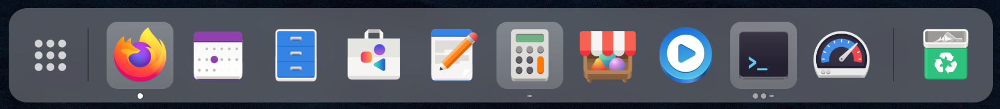

# baseDOCK

baseDOCK puts GNOME's dash on the desktop as a resizable dock. It keeps GNOME's
favorites, running apps, app menus and drag-and-drop, and adds a choice of screen
edge, a Trash shortcut and controls for size and appearance. In the overview,
it takes the place of the stock dash.

**Requires GNOME Shell 51.**



[Install](#install) · [Use the dock](#use-the-dock) · [Develop and test](#develop-and-test) · [As a reference](#as-a-reference)

## Install

Download `basedock@basedock.shell-extension.zip` from [GitHub Releases](https://github.com/tobiaseichert/basedock/releases)
and install it with:

```sh
gnome-extensions install --force basedock@basedock.shell-extension.zip
```

Log out and back in so GNOME Shell loads the extension, then enable **baseDOCK**
in the Extensions app or run `gnome-extensions enable basedock@basedock`. To
update, install the newer ZIP and log out and back in. To remove it, run
`gnome-extensions uninstall basedock@basedock`.

To build your own ZIP, clone the repository, follow [Development setup](#development-setup)
and run `npm run pack` from the repository root. Install the resulting archive
with the same command.

## Use the dock

| To | Do this |
| --- | --- |
| Move the dock | Right-click an empty part of the dock and choose **Position → Bottom**, **Left** or **Right**. The dock stays on the primary monitor. |
| Resize the dock | Drag a divider or the border facing the center of the screen. Drag up to grow and down to shrink at any dock position. The dock resizes in one-pixel icon-size steps and saves the size when you release. |
| Change the appearance | Open **Dock Style** from the dock menu. **Follow System** follows GNOME Settings → Appearance. **Default** fixes the dock to light, and **Dark** fixes it to dark. |
| Open the app grid | Click **Show Apps**. Click it again from the app grid to return to the desktop. With Show Apps focused, the **Menu** key opens the dock settings. |
| Open or empty Trash | Click **Trash** to open it in the default file manager. Its context menu offers **Empty Trash**, which asks Files to confirm the operation. If the request to Files fails, the dock opens Trash in the default file manager. |

Dividers separate Show Apps, favorites, other running apps and Trash. Running
apps have a highlighted tile and one mark per window. The focused window has
a white dot, other visible windows have gray dots, and minimized windows have
gray lines. A bar takes over if the marks would exceed the tile. Click an app
icon to focus the app. Once it has focus, click its icon again to cycle through
its visible windows in indicator order. To restore a specific minimized window,
right-click the icon and choose the window under **Open Windows**. When
possible, windows minimize toward their app's tile and restore from it.

If the dock gets crowded, icons shrink to keep it clear of the screen corners
and top bar. The apps can scroll at the minimum icon size, with Show Apps and
Trash still in view. Adding or dragging an item into the dock makes room as it
arrives. Items slide aside as you reorder them, dropped icons animate into
place, and the background blur follows workspace switches.

### Windows and the overview

The desktop dock hides when a non-minimized normal window on the
active workspace and primary monitor is maximized or fullscreen. It reserves
no work-area space. When the dock is visible, a window dragged across its
inner edge meets resistance, and its title bar stays reachable if you push it
behind the dock. A resize toward that edge stops there, and overlapping
half-screen tiles end at the dock. During a manual dock resize, tiled windows
keep their size and limit how far the dock can grow.

The dock remains visible in the overview. The window picker and app grid keep
their clearance as it changes size. The app grid's page dots stay in the same
place at all three dock positions. App grid pages can still slide behind a
side dock. The overview uses the dark palette, and GNOME's **High Contrast**
setting applies an opaque dark background with a solid border. With **Reduced
Motion**, the dock fades in place during show and hide animations.

### GSettings

| Key | Default | Values |
| --- | --- | --- |
| `position` | `bottom` | `bottom`, `left`, `right` |
| `style` | `system` | `system`, `light`, `dark` |
| `icon-size` | `48` | Preferred size in logical pixels, from `16` to `64` |

For a standard per-user installation, point `gsettings` to the extension's
schema directory. For example, to select the dark style:

```sh
gsettings --schemadir "${XDG_DATA_HOME:-$HOME/.local/share}/gnome-shell/extensions/basedock@basedock/schemas" \
    set org.gnome.shell.extensions.basedock style dark
```

## Develop and test

### Development setup

Clone the repository and run commands from its root:

```sh
git clone https://github.com/tobiaseichert/basedock.git
cd basedock
```

- **Fedora Silverblue.** Run `scripts/setup-distrobox.sh` first. It sets up the
  `basedock-dev` container with GNOME Shell packages for the host's Fedora
  release, installs the project dependencies and exports `node`, `npm` and
  `npx` to `~/.local/bin`. With that directory on your path, the npm commands
  below run inside the container. Run the setup script again or use
  `npm run setup:distrobox` to refresh it.
- **Other setups.** Install Node.js with npm, GNOME Shell 51 and its tools
  (`gnome-extensions` and `glib-compile-schemas`), then run `npm ci`. The
  integration test also uses D-Bus, GJS and GTK 4. A nested window needs
  `mutter-devkit`.

### Commands

| Command | Result |
| --- | --- |
| `npm run check` | Typechecks, lints, checks session isolation and geometry, and runs the headless integration suite. Allow about three minutes. |
| `npm run typecheck` | Checks TypeScript in `src/`. |
| `npm run lint` | Checks source and test style. Use `npm run lint -- --fix` for automatic fixes. |
| `npm run test:geometry` | Checks dock sizing and overflow without starting GNOME Shell. |
| `npm test` | Runs the integration harness with a virtual monitor and a GTK test window. |
| `npm run build` | Assembles the unpacked extension in `dist/`. |
| `npm run nested` | Opens a fresh build in a nested GNOME Shell window. |
| `npm run capture` | Captures dock and overview animations. With ImageMagick's `montage`, it also makes contact sheets. |
| `tests/style-variants.sh <dir> [--window] [--overview]` | Makes an ImageMagick comparison sheet from the directory's CSS overlays. Use `--window` to show blur over a striped test window and `--overview` to include overview shots. |
| `npm run pot` | Regenerates the gettext template after changes to translatable strings. |
| `npm run pack` | Creates `basedock@basedock.shell-extension.zip`. |
| `npm run deploy` | Installs into the real user session, including when run from the distrobox. A stylesheet-only update can reload live if the session is running the current compiled JavaScript. Log out and back in for changed JavaScript. |

ESLint follows GNOME Shell's style and installs its own dependencies on first
use. Its separate package under `lint/` uses the TypeScript 6 compiler API for
parsing. The build and typecheck use TypeScript 7.

### Test isolation and harnesses

Use the supplied runners. Both set private XDG config, data and cache paths
before starting the session bus so services such as dconf inherit the isolated
environment. The headless runner also uses a private runtime directory. The
nested runner shares the runtime directory to reach the host's Wayland socket.
Trash tests remove only their own fixtures.

A harness is an ES module in [`tests/harness/`](tests/harness/) that the runner
imports from the staged extension before `enable()`. Use `runAfterStartup()`
and `check()` from [`lib.js`](tests/harness/lib.js). Call `hideOverview()` before
desktop checks because the overview hides the wallpaper and window actors.

```sh
tests/run-headless.sh tests/harness/integration.js --window --timeout 240
BASEDOCK_MONITOR=1080x1920 npm test
BASEDOCK_SECOND_MONITOR=1200x900 npm test
```

The first command runs the integration harness directly. To run a different
harness, pass its path and include `--window` if it needs the maximized GTK
fixture. The default virtual monitor is 1600×900. The second command tests a
portrait monitor, and the third adds a second monitor for the cross-monitor
drag check. The runner prints the paths to the Shell log and artifacts.

### Translations

Wrap user-visible strings with gettext's `_()` and run `npm run pot` to extract
them and the GSettings schema summaries and descriptions. Start a new
`po/<language>.po` from [the template](po/basedock.pot) with `msginit`. Use
`msgmerge` to update an existing translation. The pack step includes the
compiled catalogs in `locale/` under the `basedock` gettext domain.

## As a reference

baseDOCK is written in TypeScript and extends GNOME Shell's `Dash`. These are
starting points for common extension tasks.

| To see how to | Start with |
| --- | --- |
| Load GJS and Shell types and use `gi://` and `resource:///` imports | [`ambient.d.ts`](src/ambient.d.ts), [`tsconfig.json`](tsconfig.json) |
| Set up and tear down an extension, or rebuild on a setting change | [`extension.ts`](src/extension.ts), [`dock.ts`](src/dock.ts) |
| Subclass Shell widgets with `GObject.registerClass` and initialize fields in `_init()` | [`dash.ts`](src/dash.ts), [`trash.ts`](src/trash.ts) |
| Patch Shell objects and restore their original state | [`stockDash.ts`](src/stockDash.ts), [`overviewRoom.ts`](src/overviewRoom.ts) |
| Coalesce state changes with compositor laters and manage signal lifetimes | [`maximizedWindows.ts`](src/maximizedWindows.ts), [`dash.ts`](src/dash.ts) |
| Handle asynchronous file and D-Bus operations with cancellation | [`trash.ts`](src/trash.ts) |
| Use Clutter gestures and anchor a context menu at the pointer | [`resize.ts`](src/resize.ts), [`dockMenu.ts`](src/dockMenu.ts) |
| Reuse directional layout and implement Mutter window constraints | [`side.ts`](src/side.ts), [`dockEdge.ts`](src/dockEdge.ts) |
| Blur moving content with Clutter clones and a rounded shader mask | [`blur.ts`](src/blur.ts) |
| Scale spacing and radii, and cross-fade an St palette change | [`geometry.ts`](src/geometry.ts), [`dockStyle.ts`](src/dockStyle.ts), [`stylesheet.css`](stylesheet.css) |
| Keep window indicators aligned as focus changes | [`windowIndicator.ts`](src/windowIndicator.ts) |
| Package a GSettings schema and a symbolic icon | [`schemas/`](schemas/), [`icons/`](icons/), [`pack.sh`](scripts/pack.sh) |

### Layout

| Path | Role |
| --- | --- |
| [`src/`](src/) | Extension modules. `extension.ts` owns startup and teardown, `dock.ts` handles placement and visibility, and `dash.ts` handles items, sizing and drag-and-drop. |
| [`stylesheet.css`](stylesheet.css) | St overrides and geometry rules shared with `src/geometry.ts` and `src/dash.ts`. |
| [`metadata.json`](metadata.json), [`schemas/`](schemas/), [`po/`](po/), [`icons/`](icons/) | Extension identity, settings, translations and the Show Apps symbol. |
| [`scripts/`](scripts/), [`lint/`](lint/) | Build, packaging, development environment and lint configuration. |
| [`tests/`](tests/) | Isolated Shell runners and harnesses for behavior, animation and style. |
| [`docs/`](docs/), [`AGENTS.md`](AGENTS.md) | README assets and contributor conventions. |

## How it was made

I designed baseDOCK to see what an AI agent could implement from a design
for a GNOME Shell extension. I defined the architecture and behavior, then
reviewed the results and changed the approach when needed. Claude wrote the
initial implementation, headless harness and frame-capture tooling and
checked the results with tests and screenshots.

One example is the workspace-switch blur. GNOME Shell puts the windows and
wallpapers in temporary actors during the animation. The dock finds and
clones those actors as they appear. See [`src/blur.ts`](src/blur.ts).

## License

baseDOCK is licensed under the GNU General Public License, version 2 or any
later version. See [LICENSE](LICENSE).
